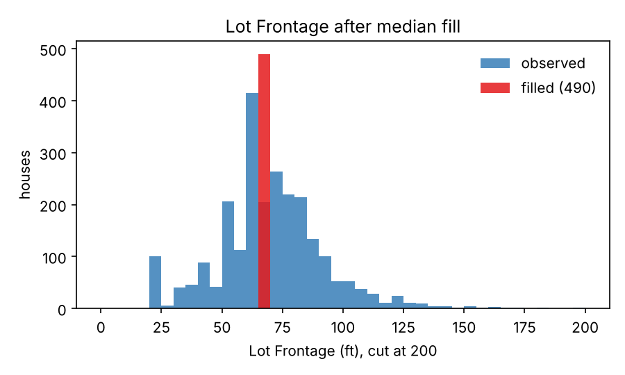
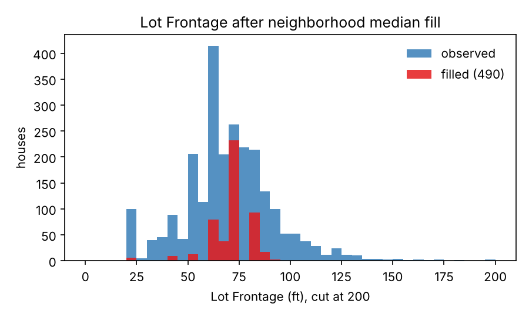
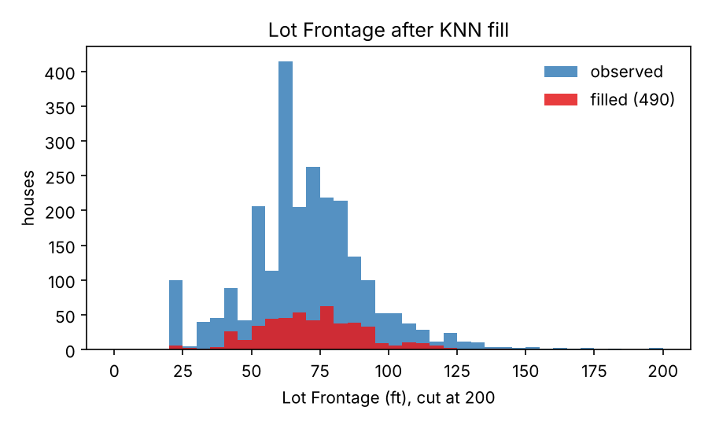

# HW5 report: Ames Housing quality audit

All numbers below are produced by `make all`; the full tables are in `reports/results/`.

## 1 Provenance

`AmesHousing.txt` (De Cock, 2011) arrived as 2,930 rows × 82 tab-separated columns, matching
the dictionary. Source URL, date, SHA-256 and terms of use are in `README.md`. The raw file
is never edited; every fix goes to `data/processed/ames_clean.csv`.

## 2 Validation: failures on the raw file

`validate.py` checks the column set and dtype family of all 82 columns, 36 range rules,
44 allowed-value sets copied from the dictionary, and 14 cross-column rules. The raw file
fails 10 rules. The cleaned file passes all of them.

| Rule that failed on the raw file | Rows | What I did (`clean.py`) |
| --- | ---: | --- |
| Garage Yr Blt in [1864, 2010] (value 2207) | 1 | NaN. Probably 2007, but that is a guess, not data |
| MS Zoning codes `C (all)`, `I (all)`, `A (agr)` (dict: C, I, A) | 25, 2, 2 | Mapped to the dictionary code, logged |
| Neighborhood `NAmes` (dict: `Names`) | 443 | Mapped, logged |
| Bldg Type `2fmCon`, `Duplex`, `Twnhs` (dict: 2FmCon, Duplx, TwnhsI) | 62, 109, 101 | Mapped, logged. `Twnhs`→`TwnhsI` assumes "inside unit", since `TwnhsE` already exists |
| Exterior 2nd `CmentBd`, `Wd Shng`, `Brk Cmn` (Exterior 1st uses the dictionary spelling) | 126, 81, 22 | Mapped, logged |
| Sale Type `WD ` (trailing space) | 2,536 | Stripped whitespace |
| Year Remod/Add ≥ Year Built | 1 (Order 851) | Year Remod/Add → NaN; can't tell which year is wrong |
| Mas Vnr Type `None` ⇔ Mas Vnr Area = 0 | 10 | 7 rows "None" with area > 0 → type NaN; 3 rows typed with area 0 → area NaN |
| Garage Qual / Garage Cond `NA` ⇔ Garage Type `NA` | 1 each (Order 1357) | A 360 sq ft detached garage cannot be "No Garage" → NaN (unknown) |

Rules that pass on the raw file but are worth noting:
- Build years may exceed Yr Sold only for `Partial` sales, which the dictionary defines as
  homes not completed when assessed (4 rows).
- Some column names differ between dictionary and file (`Exterior 1` vs `Exterior 1st`); the
  schema follows the file.

## 3 Sentinels and structural absence

**Two loads compared.** Loading with the pandas default (`pd.read_csv(path, sep="\t")`)
turns 15,030 dictionary codes into NaN. Loading with `keep_default_na=False, na_values=[""]`
keeps those codes as strings and makes only empty cells NaN. Full table: `results/na_audit.md`.

| Column(s) | `"NA"` strings | Dictionary meaning | True unknown (empty) |
| --- | ---: | --- | ---: |
| Alley | 2,732 | No alley access | 0 |
| Bsmt Qual, Bsmt Cond, BsmtFin Type 1 | 79 each | No Basement | 1 each (Order 1342, all basement fields empty) |
| Bsmt Exposure / BsmtFin Type 2 | 79 / 79 | No Basement | 4 / 2 (incl. Order 1342) |
| Fireplace Qu | 1,422 | No Fireplace | 0 |
| Garage Type / Finish / Qual / Cond | 157 / 157 / 158 / 158 | No Garage | 0 / 2 / 1 / 1 |
| Pool QC | 2,917 | No Pool | 0 |
| Fence | 2,358 | No Fence | 0 |
| Misc Feature | 2,824 | None | 0 |
| **Mas Vnr Type: `"None"`** | 1,752 | "None" = no masonry veneer | 23 |

- **No `"NA"` string in this file means "unknown".** Every true unknown is an empty cell;
  490 of them are in Lot Frontage.
- The default load also eats **`"None"`** in Mas Vnr Type: 1,752 houses with no veneer would
  be treated as missing.
- **Decision:** keep `"NA"` and `"None"` as explicit categories. One implied fill: Order 1498
  has no basement, so its empty basement bath counts became 0.

**Zeros: sentinel or true zero?** Full counts are in `results/zero_counts.md`.

| Column (zeros) | Verdict | Argument |
| --- | --- | --- |
| Total Bsmt SF (79), Garage Area & Cars (157), Pool Area (2,917), Fireplaces (1,422) | **True zero, structural** | Counts match the `NA` = none codes exactly (cross rules pass) |
| Mas Vnr Area (1,748) | True zero | Pairs with type "None" (after the 10 fixes) |
| 2nd Flr SF (1,678), BsmtFin SF 1/2, Bsmt Unf SF, porches, Wood Deck, Low Qual Fin SF | True zero | One-story houses, unfinished basements, no deck. The component sums add up exactly |
| Full Bath (12) | True zero above grade | 11 of 12 have a basement full bath; the dictionary says "above grade" |
| Bedroom AbvGr (8) | True zero above grade | The dictionary excludes basement bedrooms |
| **Kitchen AbvGr (3)** | **Suspect** | All 3 have a Kitchen Qual rating (TA), so a kitchen exists. Flagged, not changed |
| **Misc Val (3 with a Misc Feature)** | **Possible sentinel** | A shed worth $0 is possible; an unrecorded value is more likely. Flagged |
| Lot Frontage (0 zeros, min 21) | — | A lot with no street frontage *cannot* be recorded as 0, which matters for Part 5 |

## 4 Keys and duplicates

| Check | Result |
| --- | --- |
| `Order` unique | Yes: row number of the file, identifies a *record* |
| `PID` unique | Yes: parcel ID, identifies a *property*. Unique here because no parcel sold twice in 2006–10 |
| Exact duplicate rows / duplicates ignoring Order / duplicate PID | 0 / 0 / 0 |
| PIDs with a leading 0 | 2,929 of 2,930 (read as int → 9 digits, and the assessor lookup breaks) |

**Key for one sale: `PID`, read as text.** `Order` is only a row position. If a house sold
twice, the key would become (PID, Yr Sold, Mo Sold).

**Lookup join.** 28 Neighborhood codes and full names from the dictionary, joined with
`pd.merge(..., validate="many_to_one")`: **2,930 rows before and after, 0 unmatched.** Before
the `NAmes`→`Names` fix, 443 rows would not have matched.

## 5 Missingness mechanism

| | Lot Frontage | Mas Vnr Area |
| --- | --- | --- |
| Share missing | 490 / 2,930 = **16.7%** | 26 / 2,930 = **0.9%** |
| Lot Config | 13% (Inside) → **49% (CulDSac)**, χ² p = 6e-35 | flat, p = 0.98 |
| Neighborhood | 0% (BrDale) → 55% (ClearCr), p = 1e-40 | concentrated in Somerst/Gilbert, p = 6e-8 |
| Lot Area (median, missing vs present) | 10,398 vs 9,248, p = 1e-12 | 9,661 vs 9,432, p = 0.55 |
| SalePrice | $173k vs $158k, p = 5e-6 | $212k vs $160k, p = 1e-5 |
| Year Built | 1976 vs 1972, p = 0.32 | **2006 vs 1973**, p = 3e-10 |

(Mann-Whitney U for numeric, chi-square for categorical; `results/missingness_*.md`.)

**Lot Frontage.** The edge touching the street in cul-de-sac lots is awkward to measure, so
the frontage of those lots is missing at random (MAR), depending on the lot type and the lot
area, and not completely at random (MCAR). 49% of cul-de-sac lots have no frontage value
against 13% of inside lots, and the lots with blanks are bigger (median 10,398 sq ft against
9,248).

**Mas Vnr Area.** Since more than 50% of the blanks in Mas Vnr Area (14 of 26) were Partial
sales, it's MAR and not MCAR. The area is mainly blank because the assessment occurred before
the work was completed, so there was nothing finished to measure.

**What the data cannot tell us.** Our tests can only see links between the blanks and the
information we are given. They cannot tell us whether a value is blank because of the value
itself (MNAR), since we have no frame of reference for the missing values.

**If Lot Frontage were MNAR.** If frontage was measured with a tape measure, which works for
straight edges but not for curved or awkward ones, the lots left blank would be those with
the shortest, most curved fronts. The blank would then depend on the frontage value itself.

## 6 Imputation strategy and defense (at most 150 words)

| Strategy | std (23.37 before) | corr with Lot Area (0.491 before) | Distinct fills |
| --- | ---: | ---: | ---: |
| Median | 21.33 (−8.7%) | 0.363 | 1 |
| Neighborhood median | 21.72 (−7.0%) | 0.389 | 20 |
| **KNN, k=10 on (log Lot Area, Lot Config)** | **22.75 (−2.6%)** | **0.436** | 276 |

I chose KNN because the blanks depend on whether the lot is a cul-de-sac and on the lot area,
and KNN fills each blank from lots of the same type and similar area. The plain median mixes
all property types into one value, hiding the extremes (the spread drops 8.7%). The
neighborhood median does not separate cul-de-sac lots from the others in the same
neighborhood. KNN keeps realistic variation instead of uniformity: the spread drops only
2.6%, and the link with lot area stays at 0.436 against 0.363 for the median. KNN is still
only a guess, so a real measurement, even with human error, would be better. If the blanks
are really the shortest fronts (MNAR), no fill learned from the other lots would be right.

## 7 Leakage-safe evaluation

LinearRegression on log SalePrice, 14 features (README), `KFold(5, shuffle, 5110)`:

| Variant | CV RMSE (log $) |
| --- | ---: |
| A: median Lot Frontage per SalePrice quintile, full table | 0.16243 |
| B: KNN fitted on the full table, then CV | 0.16231 |
| **C: KNN inside a Pipeline** | **0.16231** |
| reference: Lot Frontage dropped | 0.16258 |

| On the 490 filled rows only | A | B | C |
| --- | ---: | ---: | ---: |
| corr(filled Lot Frontage, log SalePrice) | **0.891** | 0.219 | 0.219 |

**Which is correct, and which leak?** C is correct because it separates the training data
from the test data, avoiding leakage. A leaks the price because its fills are made from the
sale price itself: the filled values have a 0.89 link with price, against 0.35 for real
frontage. B leaks because its filler learned from the test data as well as the training
data, though only their lot details, not their prices.

**Which cannot price an unsold house?** A cannot be used on an unsold house because it has to
have the price beforehand in order to predict the price.

**How large is B versus C, and why?** The difference is tiny (0.000001) because B's filler
was never given the prices, only the lot details.

## 8 What this data cannot tell you

- **Why a value is missing.** We have no frame of reference for the missing values, so the
  data cannot tell us whether a value is blank because of the value itself.
- **The right value in a contradiction.** One house was remodeled before it was built and one
  garage is dated 2207. Since we don't know the real value, it could be anything, so we left
  it blank and did not guess.
- **Market value of unusual sales.** For the five houses over 4,000 sq ft, price does not
  depend only on size but also on how complete the construction was, so those prices do not
  show true market value.
- **Other places and times.** The data covers one town in years when the housing market was
  falling, so it cannot tell us about other places or normal years. Each house appears only
  once, so it cannot show how one house's price changes over time.
- **Causes.** Houses with more fireplaces may simply be bigger or in better areas, so the
  data shows what goes together with price, not what causes it.
